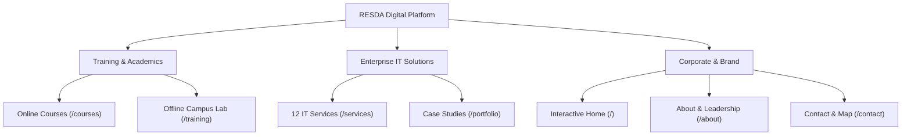
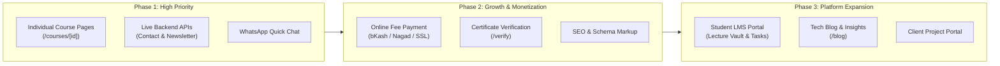

# RESDA Website — Features & Product Roadmap Documentation

**Project**: RESDA Official Web Platform  
**Technology Stack**: Next.js 16 (App Router & Turbopack), React 19, TypeScript, Tailwind CSS v4, Lucide React  
**Headquarters**: 19th Floor, Nafi Tower, 53 Gulshan Avenue, Gulshan-1, Dhaka 1212, Bangladesh  
**Status**: Development & Staging Server Active (`http://localhost:3000`)

---

## 1. Executive Summary

RESDA's digital platform is built to fulfill a dual commercial mission:
1. **Skill Empowerment for the Nation**: World-class online & offline IT training courses for students, career switchers, and professionals.
2. **Enterprise IT Solutions**: Turnkey software engineering, mobile development, cloud architecture, and cybersecurity services for corporate clients.

The platform is designed with a responsive, high-performance architecture, high-contrast typography, interactive filters, animated metric counters, and accessible UI components.

---

## 2. Current Features & Capabilities

### 2.1. Home Page (`/`)
* **Hero Section**:
  * Strategic tagline: *"Empowering IT Skills & Solutions for the Nation"*.
  * Dual primary CTAs directing users to *Explore Courses* or *Our Services*.
  * Live status pill indicating *"Admissions Open 2026"*.
  * Terminal-style live stats preview with instant access links.
* **Animated Metric Counters**:
  * Smooth requestAnimationFrame counter animations tracking 500+ Students Trained, 50+ Certified Courses, 100+ Enterprise Projects Delivered, and 15+ Senior Industry Mentors.
* **The 3 Core Pillars**:
  * **Online Training**: Remote live mentor sessions, recorded lecture library, 24/7 technical assistance.
  * **Offline Training**: In-person high-spec computer labs, peer collaboration, direct onsite debugging.
  * **IT Services**: End-to-end commercial software engineering, cloud migration, and tech consultancy.
* **Interactive Popular Courses Grid**:
  * Category filter tabs (*All, Web Dev, Python & Data, Mobile Apps, Cyber Security, Digital Marketing*).
  * 6 comprehensive course cards featuring curriculum highlights, rating stars, duration, skill level, and discounted pricing badges.
* **Enterprise IT Services Overview**:
  * Value propositions for custom web portals, mobile apps, ERPs, DevOps, UI/UX, and cybersecurity audits.
  * Free technical consultation offer card with 24-hour turnaround notice.
* **"Why Choose RESDA" Advantage**:
  * 4 detailed feature blocks: Expert Trainers, 100% Practical GitHub-ready Capstones, Globally Verifiable Certifications, and 94% Job Placement Success.
* **Student Success Stories & Testimonials**:
  * Real graduate reviews from alumni now working at leading software companies.
* **Corporate Partners Strip**:
  * Display of enterprise hiring partners and solution clients.
* **Newsletter & Tech Community Signup**:
  * Interactive email subscription form with live state validation and feedback banners.

---

### 2.2. Course Catalog (`/courses`)
* **Interactive Filtering & Search**:
  * Real-time keyword search across all courses.
  * Category filtering (*All, Web Development, Python & Data, Mobile Apps, Cyber Security, Digital Marketing*).
  * Skill level selector (*Beginner, Intermediate, Advanced*).
* **Course Card Elements**:
  * Course title, category badge, and instructor credentials.
  * Syllabus breakdown, lesson counts, and hours.
  * Star ratings and student review counts.
  * Discounted tuition fee vs. original fee.
  * Direct action buttons linking to enrollment inquiry.

---

### 2.3. Offline Campus Training (`/training`)
* **Campus Facilities Showcase**:
  * Individual computer lab workstations, gigabit Wi-Fi, air-conditioned smart classrooms, and presentation projectors.
* **Offline Programs Grid**:
  * Detailed schedule listings (Weekend batches, Evening batches, Weekday morning cohorts).
  * Batch capacity indicators, curriculum modules, and fee details.
* **4-Step Admission Pathway**:
  * Clear guide from course consultation & skills assessment to enrollment, hands-on lab training, and job placement.
* **Physical Campus Details**:
  * Lab hours, visit schedules, and directions to Nafi Tower, Gulshan-1.

---

### 2.4. Enterprise IT Services (`/services`)
* **12 Dedicated Service Offerings**:
  1. Full-Stack Web Application Development
  2. Native & Cross-Platform Mobile Applications
  3. Enterprise ERP & Automation Software
  4. UI/UX Product Design & Design Systems
  5. Cloud Infrastructure & DevOps CI/CD
  6. Cybersecurity & Penetration Testing
  7. API & Microservices Engineering
  8. Database Design, Optimization & Migration
  9. Digital Marketing & SEO Strategy
  10. IT Support, Maintenance & SLA Retainers
  11. IT Consulting & Digital Transformation
  12. Dedicated Remote Engineering Teams
* **Process Flow**:
  * Discovery & Scoping → Wireframing & Architecture → Agile Sprint Development → QA & Penetration Testing → Deployment & SLA Support.

---

### 2.5. Portfolio & Case Studies (`/portfolio`)
* **Categorized Project Showcase**:
  * Web Applications, Mobile Apps, Enterprise Systems, and UI/UX Design.
* **Case Study Details**:
  * Client profile and industry background.
  * Business challenge and architectural solution.
  * Measurable results (e.g., *+240% throughput, 99.98% uptime, 50k+ daily users*).
  * Full technology stack pills (*Next.js, Flutter, Python, PostgreSQL, AWS*).

---

### 2.6. About RESDA (`/about`)
* **Foundational Story & Vision**:
  * Mission to bridge the gap between academic theory and practical software engineering.
* **Executive Leadership Profiles**:
  * CEO, CTO, and Head of Academics with background credentials.
* **Core Values**:
  * Practical Excellence, Integrity, Student-Centric Mentorship, and Industry Relevance.

---

### 2.7. Contact & Admissions (`/contact`)
* **Inquiry Submission Form**:
  * Form inputs for Student Enrollment, Corporate IT Service Inquiries, and General Questions.
  * Client-side validation and interactive state feedback.
* **Interactive FAQ Accordion**:
  * Answers to top questions regarding batch timings, installment fees, prerequisite skills, and job placement.
* **Verified Corporate Address**:
  * Full address: *19th Floor, Nafi Tower, 53 Gulshan Avenue, Gulshan-1, Dhaka 1212, Bangladesh*.
  * Landmark info: *Near Gulshan-1 Circle / Gulshan Avenue*.
  * Direct Google Maps integration link.

---

### 2.8. Global Components (`Navbar` & `Footer`)
* **Sticky Navigation Bar**:
  * Brand mark, quick links to all sections, mobile slide-out drawer, and action buttons (*Browse Courses*, *Get in Touch*).
* **Comprehensive Footer**:
  * Quick links, service directory, verified contact info with Nafi Tower address, social media links, and copyright notices.

---

## 3. Product Roadmap: Features to Include Next

Below is the prioritized roadmap for subsequent platform releases:

### Phase 1: High Priority (Immediate Value)

1. **Dedicated Course Detail Pages (`/courses/[slug]`)**:
   * Week-by-week curriculum accordion with detailed lesson topics.
   * Prerequisites checklist and target audience profile.
   * Downloadable Course Syllabus PDF button.
   * Direct "Register for Next Batch" checkout modal.

2. **Backend API Endpoints with Automated Email Alerts**:
   * Implement Next.js Route Handlers:
     * `POST /api/contact`: Form submission handling.
     * `POST /api/newsletter`: Newsletter subscriber storage.
     * `POST /api/enroll`: Instant batch seat reservation.
   * Automated notification emails to students/clients and internal administrative notifications using **Resend** or **Nodemailer**.

3. **Instant WhatsApp / Live Chat Floating Button**:
   * Floating quick-connect widget in the bottom-right corner for direct communication with admissions advisors.

---

### Phase 2: Medium Priority (Growth & Monetization)

4. **Online Fee Payment Gateway**:
   * Direct admission fee payment via Bangladesh payment gateways (**SSLCommerz**, **bKash Merchant API**, **Nagad**, **Rocket**) and International Cards.
   * Automated digital invoice generation and receipt download.

5. **Online Certificate Verification Portal (`/verify`)**:
   * Public-facing verification lookup tool where employers can type a unique Certificate ID or scan a QR code to verify student graduation records.

6. **SEO Optimization & Structured Data (JSON-LD)**:
   * Dynamic XML sitemap generation (`/sitemap.xml`) and `robots.txt`.
   * Schema.org structured data for *EducationalOrganization*, *Course*, and *LocalBusiness* to enhance Google rich snippet search results.

---

### Phase 3: Platform Expansion (Scale & Ecosystem)

7. **Student LMS Portal (Authentication & Dashboard)**:
   * Authentication system (NextAuth.js / Clerk) with role-based access for students and mentors.
   * Access to recorded video sessions, class code repositories, assignment submissions, and batch schedules.

8. **Tech Blog & Knowledge Hub (`/blog`)**:
   * Markdown or headless CMS-powered blog featuring developer tutorials, tech career guides, and company news to drive inbound traffic.

9. **Client Project Tracker**:
   * Dedicated portal for enterprise clients to review ongoing sprint deliverables, milestones, and staging links.

---

## 4. Current vs. Next Features Comparison

| Feature Area | Current Status | Next Planned Step |
| :--- | :--- | :--- |
| **Course Catalog** | Interactive directory with filters & search | Individual `/courses/[slug]` syllabus deep-dive pages |
| **Enrollment** | Inquiries routed via Contact page | Direct online batch checkout & seat reservation |
| **Payment** | Cash / manual bank transfer info | Automated bKash, Nagad & SSLCommerz gateway |
| **Forms** | Client-side validated with feedback states | Server Route Handlers + Resend email automation |
| **Certificates** | Curriculum info on certificates | Public verification tool with QR code lookups |
| **Location / Contact** | Nafi Tower Gulshan-1 address & map link | Embedded live Google Map + WhatsApp instant chat |
| **Content & Growth** | Static landing & marketing pages | Tech Blog (`/blog`) with SEO & social share meta |
| **Student Experience** | Public marketing pages | Student LMS Portal with class recordings & labs |

---

*Document generated for RESDA development team. Updates will be tracked as each phase progresses.*
